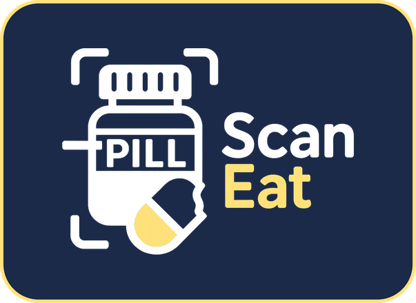
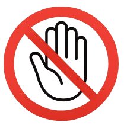
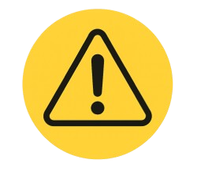
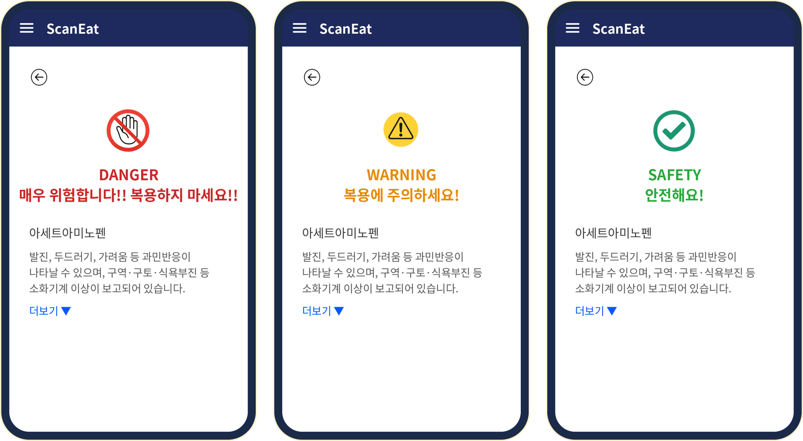
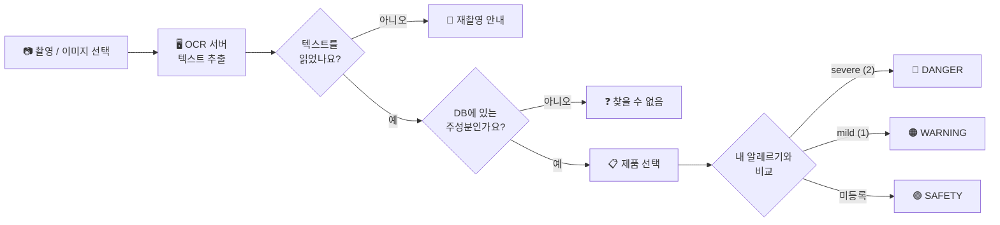
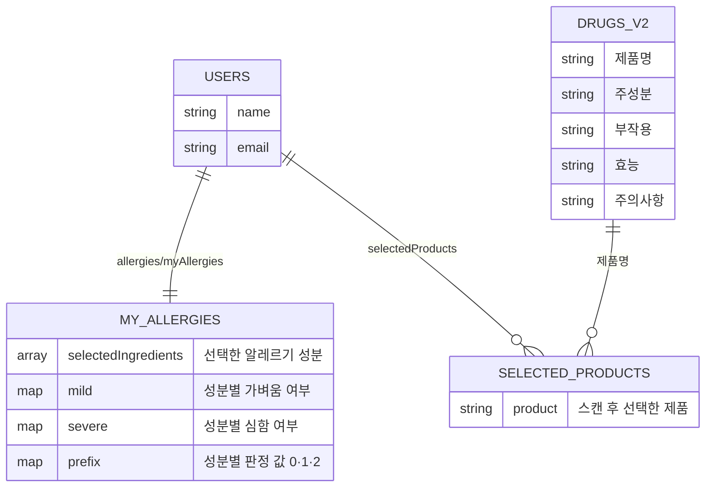
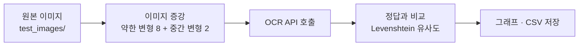

<div align="center">



# PiLLIT · ScanEat

### 💊 찍으면 알려주는 약물 알레르기 확인 앱

약 포장지를 카메라로 찍으면 OCR로 주성분을 읽고,<br/>
내 알레르기와 비교해 **먹어도 되는 약인지** 바로 알려줍니다.

<br/>


<br/>


<br/>

[소개](#-프로젝트-소개) ·
[결과 화면](#-결과-화면) ·
[주요 기능](#-주요-기능) ·
[동작 방식](#-동작-방식) ·
[기술 스택](#-기술-스택) ·
[OCR 평가](#-ocr-평가-파이프라인) ·
[실행 방법](#-실행-방법)

</div>

<br/>

## 📖 프로젝트 소개

약물 알레르기가 있는 사람은 약을 먹기 전에 성분표를 직접 읽고 확인해야 합니다. 하지만 성분명은 작고 낯선 글자로 적혀 있어 놓치기 쉽습니다.

**PiLLIT**은 이 확인 과정을 대신합니다. 내 알레르기 성분과 증상 정도를 미리 등록해 두고 약 포장지를 찍기만 하면, 세 가지 신호로 결과를 알려줍니다.

<br/>

<div align="center">

<table>
  <tr>
    <td align="center" width="240">
      <br/><br/>
      <b>🔴 DANGER</b><br/>
      <sub>심한 알레르기로 등록한 성분<br/>복용하지 마세요</sub>
    </td>
    <td align="center" width="240">
      <br/><br/>
      <b>🟠 WARNING</b><br/>
      <sub>가벼운 알레르기로 등록한 성분<br/>복용에 주의하세요</sub>
    </td>
    <td align="center" width="240">
      <br/><br/>
      <b>🟢 SAFETY</b><br/>
      <sub>등록한 알레르기에 없는 성분<br/>안전해요</sub>
    </td>
  </tr>
</table>

</div>

<br/>

## 📱 결과 화면

<div align="center">



<sub>등록한 알레르기 정도에 따라 같은 약도 다른 결과로 표시됩니다. (앱 레이아웃을 바탕으로 재구성한 예시 화면)</sub>

</div>

<br/>

## ✨ 주요 기능

<table>
  <tr>
    <td width="50%" valign="top">
      <h4>👤 회원가입 · 로그인</h4>
      Firebase Authentication 기반 이메일 계정으로 내 정보를 안전하게 보관합니다.
    </td>
    <td width="50%" valign="top">
      <h4>📝 알레르기 등록</h4>
      의약품 성분 목록에서 검색해 내 알레르기 성분을 고릅니다.
    </td>
  </tr>
  <tr>
    <td valign="top">
      <h4>🌡️ 증상 정도 설정</h4>
      성분마다 가벼움(mild) 또는 심함(severe)을 지정해 경고 수준을 나눕니다.
    </td>
    <td valign="top">
      <h4>📷 약 스캔</h4>
      카메라로 찍거나 갤러리 이미지를 골라 OCR 서버로 보냅니다.
    </td>
  </tr>
  <tr>
    <td valign="top">
      <h4>🔎 성분 매칭</h4>
      OCR 텍스트에서 의약품 DB의 주성분을 찾아내고, 같은 성분의 제품 중 내 약을 선택합니다.
    </td>
    <td valign="top">
      <h4>💊 약 정보 확인</h4>
      부작용, 효능, 주의사항을 확대해서 볼 수 있는 화면으로 제공합니다.
    </td>
  </tr>
</table>

<br/>

## 🔄 동작 방식



1. 앱이 이미지를 JPEG로 압축해 OCR 서버(`/ocr`)에 `multipart/form-data`로 전송합니다.
2. 받은 텍스트에서 한글·영문·숫자만 남겨 정규화한 뒤, Firestore `drugs_v2` 컬렉션의 `주성분`이 포함되어 있는지 찾습니다.
3. 일치하는 성분의 제품 목록을 보여주고, 사용자가 실제 제품을 고릅니다.
4. 사용자의 알레르기 등록 정보(`prefix`)와 비교해 결과를 판정하고, 약의 상세 정보를 함께 보여줍니다.

<br/>

## 🛠 기술 스택

| 구분 | 사용 기술 |
|:---:|---|
| **앱** | Android (Java) · Fragment 기반 단일 Activity 구조 · Material Components |
| **카메라** | CameraX |
| **인증** | Firebase Authentication |
| **데이터베이스** | Cloud Firestore |
| **파일 저장** | Firebase Storage |
| **OCR** | 별도 OCR 서버(HTTP API) · `HttpURLConnection` 통신 |
| **평가** | Python · OpenCV · Pillow · NumPy · Matplotlib · Requests |

<br/>

## 🗄 Firestore 구조



<br/>

## 📊 OCR 평가 파이프라인

저장소 루트의 `Add OCR evaluation pipeline` 파일은 OCR 서버의 성분 인식 성능을 측정하는 Python 스크립트입니다.



| 단계 | 내용 |
|:---:|---|
| **증강** | 밝기 · 대비 · 블러 · 회전 · 크롭 · 노이즈 · JPEG 압축을 무작위로 적용 |
| **비교** | OCR 텍스트를 정답 길이만큼 슬라이딩하며 Levenshtein 거리 기반 유사도의 최댓값 계산 |
| **결과** | 이미지별 막대그래프 · 평균 유사도 도넛 그래프 · `ingredient_results.csv` |

<details>
<summary><b>실행 방법 펼치기</b></summary>

<br/>

`test_images/`(이미지)와 `ground_truth/`(같은 이름의 `.txt` 정답 파일) 폴더를 먼저 준비합니다.

```bash
pip install opencv-python pillow numpy matplotlib requests
python "Add OCR evaluation pipeline"
```

</details>

<br/>

## 🚀 실행 방법

```bash
git clone https://github.com/Hiver0205/PiLLIT.git
```

1. Android Studio에서 `pillitscaneatYSM` 폴더를 엽니다.
2. Gradle 동기화가 끝나면 에뮬레이터나 실제 기기에서 실행합니다. (minSdk 24)

> [!NOTE]
> 앱은 Firebase 프로젝트와 OCR 서버에 연결되어야 동작합니다. 직접 구성하려면 Firebase에서 Authentication · Firestore · Storage를 켜고 `app/google-services.json`을 본인 것으로 교체한 뒤, `drugs_v2` 컬렉션에 의약품 데이터를 넣어야 합니다.

<br/>

## 📁 폴더 구성

<details>
<summary><b>전체 구조 펼치기</b></summary>

<br/>

```
PiLLIT/
├── README.md
├── logo.png                         # README용 로고
├── result_screens.png               # README용 결과 화면 이미지
├── Add OCR evaluation pipeline      # OCR 평가 스크립트 (Python)
└── pillitscaneatYSM/                # 안드로이드 프로젝트
    └── app/src/main/
        ├── java/com/example/pillit_scaneat/
        │   ├── SplashActivity, StartActivity          # 시작 화면
        │   ├── LoginActivity, SignupActivity          # 로그인·회원가입
        │   ├── MainActivity, HomeFragment             # 메인·내비게이션
        │   ├── AllergyFragment                        # 알레르기 성분 선택
        │   ├── AllergySymptomFragment                 # 증상 정도 설정
        │   ├── ScanMenuFragment, ScanFragment         # 스캔 메뉴·촬영/업로드
        │   ├── ScanCameraFragment, ImageScanFragment  # 카메라·이미지 스캔
        │   ├── ProductSelectFragment                  # 제품 선택
        │   ├── ResultFragment                         # 위험도 결과
        │   ├── ProductDetailFragment                  # 약 상세 정보
        │   ├── OCRFailFragment, NotFoundFragment      # 실패·미등록 안내
        │   └── UserInfoFragment, ChangePasswordActivity  # 내 정보
        └── res/                                       # 레이아웃·이미지·문자열
```

</details>

<br/>

---

> [!WARNING]
> 본 앱은 학습·연구 목적의 **보조 도구**이며, 의사·약사의 전문적인 판단을 대체하지 않습니다. OCR 인식 오류나 DB에 없는 약이 있을 수 있으므로, 실제 복용 전에는 반드시 전문가와 상담하세요.

<div align="center">
<br/>
<sub>Made with 💊 by PiLLIT Team</sub>
</div>
